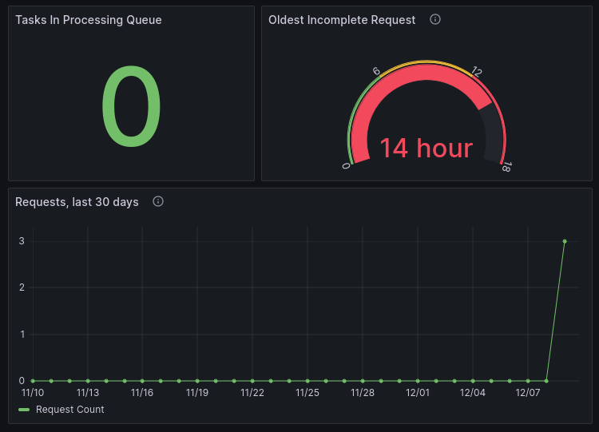

# Monitoring

GeoQuery exports Prometheus metrics from every component, and the Helm chart ships a Grafana dashboard and alert rules for the cluster's monitoring stack (kube-prometheus-stack) to pick up. The chart doesn't install Prometheus or Grafana itself.

## What's measured

| Source | Metrics | Port |
|---|---|---|
| Backend | django-prometheus: requests, latency, database queries (`PROMETHEUS_ENABLED`) | 9091 |
| Processing workers | `geoquery_extract_*`: task throughput, where each task's time goes, claim cost, leases (`analytics/metrics.py`) | 9091 |
| Background workers | Background job progress and request completion (`analytics/background_metrics.py`) | 9091 |
| Database | CloudNativePG's exporter, plus GeoQuery's own queries (`cnpg_geoquery_*`): wait events, extract table counters, task state estimates, requests by status, `pg_stat_io`, top statements | 9187 |
| pgBouncer | `cnpg_pgbouncer_*`, labelled by pooler | 9127 |
| RabbitMQ | Queue depths and rates | |

The extract worker runs tasks in child processes, so its metrics need `PROMETHEUS_MULTIPROC_DIR` set; the parent sums the children's values and serves them on `WORKER_METRICS_PORT`.

Throughput swings minute to minute, so compare hours, not minutes, when judging a change ([Database, Appendix C](../../database.md#appendix-c-measurement-recipes)).

## Turning it on

Everything is behind `metrics.enabled` in the chart, which needs the Prometheus Operator's CRDs. With it on, the chart creates a PodMonitor for each component above.

- **Dashboard:** `metrics.grafanaDashboard` creates a ConfigMap from `dashboards/geoquery.json` in the chart, labelled so the Grafana sidecar loads it. Its uid and title include the namespace, so staging and production get separate dashboards. The JSON is a plain Grafana export: edit the dashboard in Grafana, export it, and commit it to the chart.
- **Alerts:** `metrics.prometheusRule.enabled` adds a `PrometheusRule`. Today it has one alert, `GeoQueryExtractTasksExhausted`: extract tasks that have used every retry, for 15 minutes.

## Logs

Every process logs to stdout, so `kubectl logs` and the cluster's log collection see everything ([Cluster operations](../../deploying/kubernetes/development.md#looking-around)).
